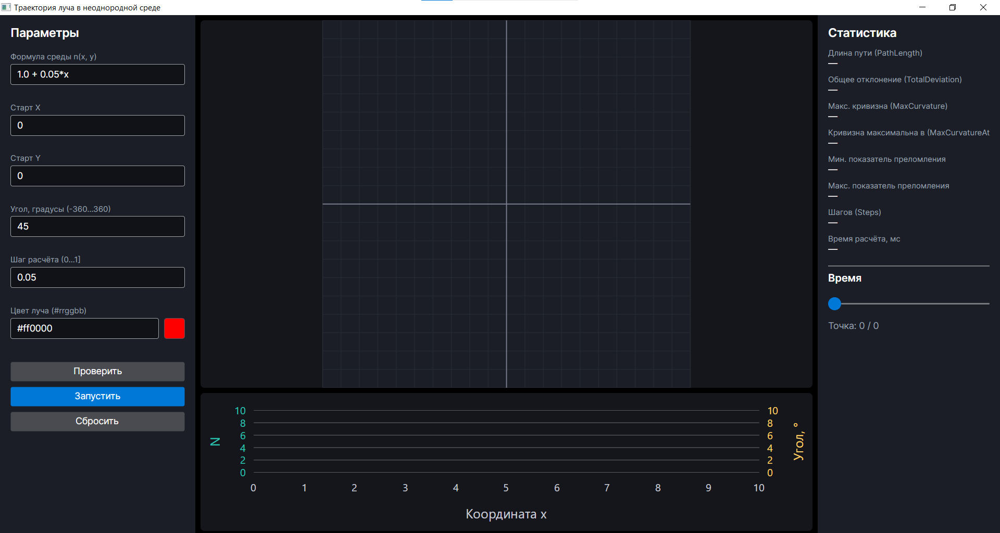

# Преломление света в неоднородных средах





Программа моделирует и визуализирует прохождение луча света через среду, свойства которой плавно меняются от точки к точке. Луч не идёт по прямой — он искривляется, а рядом с траекторией показывается график изменения показателя преломления и угла наклона луча вдоль пути.

**Полное описание программы:** [`docs/description.md`](docs/description.md)

---

## Архитектура

```text

┌─────────────────────────────────────────────────────────────┐
│                    Avalonia-приложение                      │
│  ┌───────────────────────────────────────────────────────┐  │
│  │  UI — то, что видит пользователь       (Захар)        │  │
│  │  • поля ввода формулы среды                           │  │
│  │  • поля координат, угла, шага, цвета                  │  │
│  │  • валидация ввода                                    │  │
│  │  • анимация луча (Canvas + DrawingContext)            │  │
│  │  • график преломления (LiveChartsCore)                │  │
│  │  • ползунок времени, панель статистики                │  │
│  └───────────────────────────────────────────────────────┘  │
└──────────────────────────────┬──────────────────────────────┘
                               │  HTTP-запрос → JSON
                               ▼
┌─────────────────────────────────────────────────────────────┐
│  Controller — «приёмная»       (ASP.NET Core)               │
│  • принимает HTTP-запросы из UI                             │
│  • передаёт их в Core                                       │
│  • возвращает ответ обратно в UI                            │
└──────────────────────────────┬──────────────────────────────┘
                               │  вызов C# методов
                               ▼
┌─────────────────────────────────────────────────────────────┐
│  Core — «мозг»                            (Всеволод)        │
│  • читает формулу среды (Парсер)                            │
│  • проверяет её на корректность                             │
│  • считает траекторию луча в неоднородной среде             │
│  • находит точку максимальной кривизны                      │
│  • считает статистику (путь, отклонение, шаги, время)       │
└─────────────────────────────────────────────────────────────┘

Три слоя общаются между собой только через JSON. UI ничего не знает о физике, Core ничего не знает о кнопках. Это позволяет Захару и Всеволоду работать параллельно и не мешать друг другу.

## Кто что пишет

| Участник | Что делает |
| :--- | :--- |
| **Всеволод** | Папки `Core/`, `Controller/` и `Core.Tests/`. Пишет на C#: парсер формул, проверку корректности, движок расчёта траектории луча, статистику, юнит-тесты. Controller — ASP.NET Core сервер с двумя эндпоинтами. |
| **Захар** | Папку `UI/`. Пишет на C# (Avalonia): окно с полями ввода, кнопки, валидацию, анимацию луча через `Canvas` и `DrawingContext`, график преломления на LiveChartsCore, ползунок времени, панель статистики. Общается с Controller через `HttpClient`. |
| **Максим** | Тимлид. Координация, приёмка и одобрение пул-реквестов, слияние `development` в `main`, разрешение конфликтов. Помогает обоим, если что-то не сходится. |


Структура папок
lab1/
├── README.md                  ← этот файл
├── LICENSE                    ← лицензия MIT
├── .gitignore
├── .editorconfig
├── global.json
├── lab1.sln                   ← solution, объединяющий все проекты
│
├── docs/
│   ├── description.md         ← описание программы
│   └── screenshot.png         ← скриншот интерфейса
│
├── Core/                      ← пишет Всеволод (C#, библиотека классов)
├── Controller/                ← пишет Всеволод (C#, ASP.NET Core)
├── UI/                        ← пишет Захар (C#, Avalonia)
└── Core.Tests/                ← тесты ядра (xUnit)

---

## Как слои общаются: JSON-контракт

UI общается с Controller через два эндпоинта. Формат запроса и ответа зафиксирован заранее.

**1. Проверка параметров**

**`POST /api/simulate/check`** — лёгкая проверка ввода, ничего не считает.

**Запрос:**
```json

{
  "environmentFormula": "1.0 + 0.05*x",
  "startPoint": { "x": 0.0, "y": 0.0 },
  "startAngle": 45.0,
  "stepSize": 0.01,
  "bounds": { "xMin": -10.0, "xMax": 10.0, "yMin": -10.0, "yMax": 10.0 },
  "color": "#ff0000"
}


```

**Ответ при успехе:**
```json
{ "valid": true }
```

**Ответ при ошибке:**
```json

{
  "valid": false,
  "errors": [
    {
      "code": "INVALID_FORMULA",
      "field": "environmentFormula",
      "message": "Формула содержит неизвестный символ: $"
    }
  ]
}

```

### 2. Полный расчёт

**`POST /api/simulate/run`** — тяжёлый расчёт траектории луча.

**Ответ при успехе:**
```json

{
  "success": true,
  "trajectory": [
    { "x": 0.0,  "y": 0.0,  "n": 1.000, "angle": 45.0 },
    { "x": 0.01, "y": 0.01, "n": 1.001, "angle": 44.8 }
  ],
  "statistics": {
    "pathLength": 3.14,
    "totalDeviation": 12.5,
    "maxCurvature": 0.42,
    "maxCurvatureAt": { "x": 1.23, "y": 2.34 },
    "refractionIndexMin": 1.0,
    "refractionIndexMax": 1.5,
    "steps": 314,
    "computationTimeMs": 18
  }
}

```

### Формат ошибки — единый

```json

{
  "code": "INVALID_FORMULA",
  "field": "environmentFormula",
  "message": "Понятное человеку объяснение"
}
```

### Коды ошибок

| Код | Когда |
|---|---|
| `EMPTY_FIELD` | Поле пустое |
| `INVALID_FORMULA` | Формула содержит недопустимые символы |
| `UNBALANCED_PARENTHESES` | Не сбалансированы скобки |
| `DIVISION_BY_ZERO` | Деление на ноль в формуле |
| `OUT_OF_BOUNDS` | Начальная точка вне области расчёта |
| `INVALID_ANGLE` | Угол вне допустимого диапазона |
| `INVALID_STEP` | Шаг ≤ 0 или слишком большой |
| `INVALID_COLOR` | Цвет не из допустимого набора |
| `NO_SOLUTION` | Уравнение не имеет решения |
| `CALCULATION_FAILED` | Ошибка во время расчёта |

### Единицы измерения

- **Время** — секунды
- **Координаты** — условные единицы оси
- **Углы** — градусы
- **Цвета** — строки вида `#rrggbb`
- **Все поля** — в camelCase

---

## Правила совместной работы

- **Ветки:** `main` (финальная, только тимлид), `development` (сюда стекаются PR), `feature/...` (личные ветки разработчиков: `feature/core` — Всеволод, `feature/ui` — Захар).
- **Прямой push в `main` и `development` запрещён.** Только через Pull Request.
- **Ветки не удаляем, коммиты не склеиваем** — проверяющий должен видеть весь процесс.
- **Откат — только `git revert`**, не `git reset`.
- **Сообщения коммитов — на английском**, в повелительном наклонении: `feat(core): add parser`, `fix(ui): correct timer`.
- **`git status` в любой непонятной ситуации.**

---

## Лицензия

MIT — см. [`LICENSE`](LICENSE).

